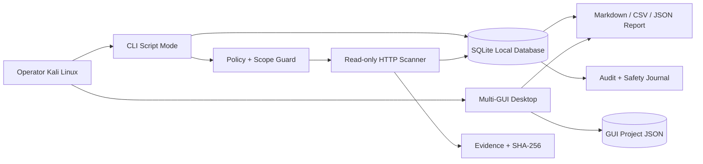

# VENOM4PRO
## Authorized Security Desk — Kali Linux Script + Multi-GUI


> **Venom4pro** adalah workspace lokal untuk pekerjaan keamanan yang berwenang: mencatat authorization, mengelola scope, menyimpan asset dan finding, menjalankan pemeriksaan HTTP/HTTPS **read-only**, mengumpulkan evidence, serta membuat laporan.

Tidak ada web server, frontend browser, remote command execution, brute force, exploit execution, payload delivery, DDoS, credential guessing, atau counter-attack.

---

## 1. Tampilan 3D arsitektur



### Cara membaca diagram

1. **Operator** memulai aplikasi dari terminal Kali Linux.
2. **CLI** adalah mode utama untuk automation, SQLite, scan, backup, dan reporting.
3. **Multi-GUI** adalah dashboard desktop untuk inventory, authorization, finding, dan laporan manual.
4. **Policy + Scope Guard** harus lolos sebelum pemeriksaan target dijalankan.
5. Scanner hanya menggunakan **GET/HEAD** dengan timeout, delay, body limit, dan TLS verification.
6. Semua hasil lokal dapat diaudit melalui database, evidence checksum, audit event, dan safety journal.

---

## 2. Fitur utama

### Script mode

- SQLite database lokal.
- Authorization record dan scope rules.
- Asset inventory.
- Finding lifecycle: `draft → open → accepted → remediated → verified → closed`.
- Automatic read-only HTTP/HTTPS checks.
- Security headers.
- Cookie attributes.
- Passive technology hints.
- TLS handshake metadata.
- `robots.txt`, `sitemap.xml`, `openapi.json`, dan `swagger.json`.
- Batch scan sequential dengan delay.
- Backup dan restore.
- Import/export JSON.
- Database integrity check.
- Migration manager.
- Evidence dengan SHA-256 checksum.
- Report Markdown, CSV, dan JSON.
- Tool inventory lokal Kali.
- Health check dan environment doctor.
- Search, pagination, risk scoring, duplicate finding detection.

### Multi-GUI desktop

GUI PySide6 mempunyai panel:

- **Overview** — metric asset, finding, evidence, risk score, dan activity.
- **Tool Inventory** — deteksi tool lokal, policy status, dan versi.
- **Authorization** — membuat engagement record dan scope.
- **Findings** — membuat finding dengan severity, CVSS, impact, dan remediation.
- **Reports & Audit** — export Markdown, CSV, JSON, serta melihat audit trail.

Wallpaper 3D tersedia untuk layout utama, wide, dan compact:

- `assets/wallpapers/venom4pro-main.png`
- `assets/wallpapers/venom4pro-wide.png`
- `assets/wallpapers/venom4pro-compact.png`

---

## 3. Persyaratan sistem

- Kali Linux 2024+ atau Debian-based Linux.
- Python 3.10+.
- `python3-venv`.
- `python3-pip`.
- SQLite3.
- Desktop environment jika ingin menjalankan GUI.
- Koneksi internet hanya diperlukan untuk instalasi dependency atau target yang memang diotorisasi.

---

## 4. Instalasi paling mudah

Clone repository:

```bash
git clone https://github.com/BGXTEAMID/venom4pro.git
cd venom4pro
```

Beri permission dan install:

```bash
chmod +x install_venom4.sh run.sh venom4.py
./install_venom4.sh
```

Installer akan:

1. memasang Python, venv, pip, dan SQLite jika tersedia melalui `apt-get`;
2. membuat `.venv`;
3. memasang `pytest` dan `PySide6`;
4. menyiapkan database default;
5. memberi permission pada launcher.

Cek instalasi:

```bash
./run.sh status
./run.sh health
./run.sh integrity
```

Jika hanya ingin mode CLI dan tidak memerlukan GUI, dependency PySide6 tetap aman terpasang tetapi tidak akan dijalankan.

---

## 5. Lokasi data

Database SQLite default:

```text
~/.local/share/venom4pro/venom4pro.db
```

Override database:

```bash
./run.sh --db /path/to/project.db status
```

atau:

```bash
VENOM4PRO_DB=/path/to/project.db ./run.sh status
```

Project JSON GUI lama/desktop disimpan di:

```text
~/.local/share/bgxteam-security-desk/project.json
```

File lama repository tetap dipertahankan di:

```text
legacy/original/
```

---

## 6. Quick start CLI

### 6.1 Inisialisasi

```bash
./run.sh init
./run.sh status
```

### 6.2 Buat authorization scope

Gunakan contoh local lab:

```bash
./run.sh authorization scripts/example_authorization.json
```

Contoh scope:

```json
{
  "rules": [
    {"value": "127.0.0.1", "kind": "ip", "included": true},
    {"value": "localhost", "kind": "domain", "included": true}
  ]
}
```

**Jangan memasukkan target pihak lain tanpa izin tertulis.**

### 6.3 Tambahkan asset

```bash
./run.sh asset scripts/example_asset.json
```

Asset akan mendapat flag `in_scope` berdasarkan authorization aktif.

### 6.4 Tambahkan finding

```bash
./run.sh finding scripts/example_finding.json
```

Transisi finding:

```bash
./run.sh transition FINDING_ID open
./run.sh transition FINDING_ID accepted
./run.sh transition FINDING_ID remediated
./run.sh transition FINDING_ID verified
./run.sh transition FINDING_ID closed
```

### 6.5 Jalankan scan read-only

Local lab:

```bash
./run.sh scan http://127.0.0.1:3000 --delay 1 --timeout 8
```

Target HTTPS yang memang diotorisasi:

```bash
./run.sh scan https://authorized.example \
  --delay 1 \
  --timeout 10 \
  --max-body 512000 \
  --no-openapi
```

Parameter keselamatan:

| Parameter | Fungsi |
|---|---|
| `--delay` | Jeda antarkoneksi |
| `--timeout` | Batas waktu tiap request |
| `--max-body` | Batas body response |
| `--no-robots` | Lewati `robots.txt` |
| `--no-sitemap` | Lewati `sitemap.xml` |
| `--no-openapi` | Lewati dokumentasi API umum |
| `--no-verify-tls` | Hanya gunakan pada lab yang dipahami risikonya |

Target di luar scope akan ditolak sebelum request dibuat.

### 6.6 Batch read-only scan

Buat file target:

```text
# hanya target yang sudah diotorisasi
http://127.0.0.1:3000
https://authorized.example
```

Jalankan:

```bash
.venv/bin/python scripts/venom4pro_batch.py targets.txt \
  --db ~/.local/share/venom4pro/venom4pro.db \
  --delay 1 \
  --timeout 8 \
  --output reports/batch-results.json
```

Batch berjalan berurutan dan menyimpan hasil setiap target ke SQLite.

---

## 7. Multi-GUI desktop

Pastikan dependency GUI terpasang:

```bash
./install_venom4.sh
```

Jalankan:

```bash
./run.sh gui
```

Atau langsung:

```bash
.venv/bin/python scripts/venom4pro_gui.py
```

### Alur penggunaan GUI

1. Buka halaman **Authorization**.
2. Isi client, engagement, reviewer, window, emergency contact, dan scope.
3. Klik **Save authorization**.
4. Tambahkan asset melalui form asset.
5. Buka **Findings** untuk mendokumentasikan hasil review.
6. Isi severity, CVSS, summary, impact, dan remediation.
7. Buka **Reports & Audit** untuk export.
8. Buka **Inventory** untuk melihat tool yang tersedia di mesin lokal.

GUI tidak menjalankan exploit atau remote execution. GUI adalah dashboard desktop lokal untuk pencatatan dan dokumentasi.

Jika GUI gagal dibuka:

```bash
python3 -c "import PySide6; print('PySide6 OK')"
```

Jika muncul `ModuleNotFoundError`, ulangi:

```bash
./install_venom4.sh
```

---

## 8. Maintenance SQLite

### Health dan metrics

```bash
./run.sh health
./run.sh metrics
./run.sh integrity
```

### Backup

```bash
./run.sh backup ./backups/project-$(date +%Y%m%d-%H%M%S).db
```

### Export project

```bash
./run.sh export ./exports/project.json
```

### Restore dan import

```bash
.venv/bin/python scripts/venom4pro_admin.py restore ./backups/project.db
.venv/bin/python scripts/venom4pro_admin.py import ./exports/project.json
```

Restore membuat backup database aktif sebelum penggantian secara default.

### Migration

```bash
./run.sh migrate status
./run.sh migrate apply
./run.sh migrate verify
```

### Vacuum

```bash
.venv/bin/python scripts/venom4pro_admin.py vacuum
```

---

## 9. Reporting, search, dan audit

Export Markdown melalui CLI:

```bash
./run.sh report reports/assessment.md
```

Format lain:

```bash
.venv/bin/python scripts/venom4pro_admin.py report reports/assessment.csv --format csv
.venv/bin/python scripts/venom4pro_admin.py report reports/assessment.json --format json
```

Search:

```bash
./run.sh search header
./run.sh search localhost
```

Audit:

```bash
./run.sh audit
```

Safety journal:

```bash
.venv/bin/python scripts/venom4pro_doctor.py --json environment
.venv/bin/python scripts/venom4pro_admin.py integrity
```

---

## 10. Struktur project

```text
venom4.py                         # entry point CLI
run.sh                            # launcher CLI atau GUI
install_venom4.sh                 # installer Kali Linux
scripts/venom4pro.py              # CLI utama
scripts/venom4pro_gui.py          # launcher multi-GUI
scripts/venom4pro_admin.py        # backup, restore, export, report
scripts/venom4pro_batch.py        # batch read-only scan
scripts/venom4pro_doctor.py       # health dan inventory lokal
scripts/venom4pro_migrate.py      # migration utility
bgxdesk/main.py                   # multi-panel PySide6 desktop GUI
bgxdesk/domain/                   # model domain
bgxdesk/services/sqlite_store.py  # repository SQLite
bgxdesk/services/scanner.py       # scanner read-only reusable
bgxdesk/services/policy.py        # scope dan operation policy
bgxdesk/services/evidence.py      # evidence checksum dan attachment
bgxdesk/services/reporting.py     # Markdown, CSV, JSON report
bgxdesk/services/project_ops.py   # backup, restore, import, export
bgxdesk/services/inventory.py     # local tool inventory
bgxdesk/services/health.py        # local readiness check
migrations/                       # migration SQL
assets/wallpapers/                # wallpaper Venom4pro 3D
legacy/original/                  # file lama yang dipertahankan
tests/                            # unit dan integration tests
```

---

## 11. Testing dan quality check

Compile:

```bash
python3 -m compileall -q venom4.py scripts bgxdesk tests
```

Test suite:

```bash
pytest -q
```

Diff check:

```bash
git diff --check
```

Total code Python aktif dipertahankan sebagai logika modular bermakna, bukan duplikasi ribuan baris dalam satu file.

---

## 12. Troubleshooting cepat

### `Environment belum ada`

```bash
./install_venom4.sh
```

### `Target is outside active authorization scope`

Periksa authorization:

```bash
./run.sh status
./run.sh authorization scripts/example_authorization.json
```

Pastikan hostname, IP, wildcard, CIDR, port, atau URL sesuai target.

### GUI tidak tampil melalui SSH

GUI memerlukan desktop session atau X11/Wayland forwarding. Untuk server/headless Kali, gunakan CLI:

```bash
./run.sh status
./run.sh health
./run.sh scan http://127.0.0.1:3000
```

### Database rusak atau ragu

```bash
./run.sh integrity
.venv/bin/python scripts/venom4pro_admin.py backup ./backups/recovery.db
```

### Periksa tool lokal

```bash
.venv/bin/python scripts/venom4pro_doctor.py --json tools
```

---

## 13. Prinsip penggunaan

- Hanya gunakan pada sistem yang Anda miliki atau punya authorization tertulis.
- Simpan authorization dan scope sebelum assessment.
- Mulai dari local lab atau staging.
- Gunakan delay dan timeout konservatif.
- Review evidence sebelum membuat finding.
- Jangan menyimpan credential di JSON, SQLite, report, atau evidence.
- Backup database sebelum restore/import besar.
- Gunakan GUI untuk dokumentasi dan CLI untuk operasi reproducible.

**Venom4pro adalah alat dokumentasi dan pemeriksaan defensif yang lokal, terukur, dan dapat diaudit.**
