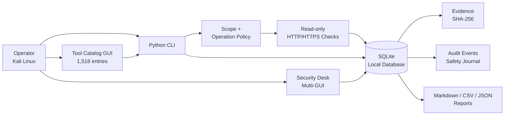
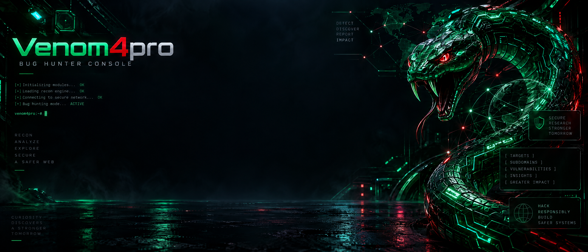

<div align="center">

# VENOM4PRO

### Authorized Cybersecurity Desk for Kali Linux

**Local-first security assessment, tool catalog, SQLite evidence, and multi-GUI operations.**

[](https://www.python.org/)
[](https://www.kali.org/)
[](https://github.com/BGXTEAMID/venom4pro)
[](scripts/venom4pro_tools.py)
[](README.md)

[Overview](#project-overview) · [Installation](#installation) · [CLI](#cli-commands) · [GUI](#multi-gui-desktop) · [Screenshots](#live-execution-screenshots) · [Security](#security-and-privacy)

</div>

<p align="center">
  
</p>

> **Venom4pro** is a local Kali Linux workspace for authorized security work. It combines a Python CLI, SQLite project database, read-only HTTP/HTTPS checks, evidence checksums, a 1,518-entry tool catalog, and PySide6 desktop interfaces.

> The project is designed for systems that you own or are explicitly authorized to assess. It does not provide brute force, credential theft, exploit delivery, payload generation, persistence, destructive actions, DDoS, or remote command execution.

---

## Table of Contents

1. [Project Overview](#project-overview)
2. [Key Features](#key-features)
3. [3D Architecture Diagram](#3d-architecture-diagram)
4. [Technology Stack](#technology-stack)
5. [Project Structure](#project-structure)
6. [Installation](#installation)
7. [Configuration](#configuration)
8. [Quick Start](#quick-start)
9. [Live Execution Screenshots](#live-execution-screenshots)
10. [Example Terminal Output](#example-terminal-output)
11. [GUI Preview](#gui-preview)
12. [Usage Examples](#usage-examples)
13. [CLI Commands](#cli-commands)
14. [Configuration Reference](#configuration-reference)
15. [Security and Privacy](#security-and-privacy)
16. [Troubleshooting](#troubleshooting)
17. [Testing and Verification](#testing-and-verification)
18. [Roadmap](#roadmap)
19. [Contributing](#contributing)
20. [License](#license)
21. [Disclaimer](#disclaimer)
22. [Author and Contact](#author-and-contact)

---

## Project Overview

Venom4pro is organized as three local layers:

- **Script layer:** reproducible CLI commands for project data, policy checks, read-only assessment, reports, backup, migration, and inventory.
- **Data layer:** SQLite persistence for authorization, scope rules, assets, findings, evidence, scan results, and audit events.
- **Desktop layer:** optional PySide6 multi-GUI and a dedicated Tool Catalog GUI using the supplied Venom4pro wallpaper.

The repository also contains a curated catalog of **1,518 cybersecurity tools** across 21 categories. The catalog is metadata-oriented: it records tool purpose, package family, risk policy, package name, and safe inspection commands. It does not execute catalog entries.

---

## Key Features

### Assessment and project management

- Explicit authorization records and included/excluded scope rules.
- Asset inventory with environment and ownership metadata.
- Finding lifecycle with validation and controlled status transitions.
- Local audit events and append-only safety journal.
- Evidence storage with SHA-256 checksums and finding attachment.
- Markdown, CSV, and JSON reporting.

### Read-only scanner

- HTTP status and redirect observations.
- Recommended security-header checks.
- Cookie attribute observations.
- Passive technology hints.
- TLS handshake metadata.
- Optional `robots.txt`, `sitemap.xml`, `openapi.json`, and `swagger.json` checks.
- Timeout, delay, body-size, TLS, and scope enforcement.
- GET/HEAD-only operation.

### Tool catalog

- 1,518 catalog entries.
- 21 categories, including OSINT, DNS, web/API, vulnerability assessment, code security, cloud, containers, wireless, forensics, reverse engineering, mobile, Windows/AD, fuzzing, crypto/stego, reporting, and defensive utilities.
- Live search and risk filtering in the standalone GUI.
- Safe command matrix: `command -v`, `--version`, `--help`, and `apt-cache policy`.
- Non-executing APT installation plan generation.

### Desktop interfaces

- Main multi-panel Security Desk GUI.
- Dedicated Tool Catalog GUI.
- 3D cyber security wallpapers included in `assets/wallpapers/`.
- Headless environments receive a clear PySide6/display message and can continue with CLI mode.

---

## 3D Architecture Diagram



### Data flow

1. The operator creates an authorization record.
2. Scope policy evaluates the requested target.
3. Only an allowed target can reach the read-only scanner.
4. Results are persisted locally as scan records and evidence.
5. Audit events record project actions.
6. Reports are generated from the local database.

---

## Technology Stack

| Layer | Technology |
|---|---|
| Language | Python 3.10+ |
| Database | SQLite with WAL and integrity checks |
| Desktop GUI | PySide6 / Qt Fusion style |
| Persistence | SQLite for CLI, local JSON project store for existing Security Desk GUI |
| Validation | Custom policy engine and pytest-compatible tests |
| Reports | Markdown, CSV, JSON |
| Visual assets | PNG wallpaper assets included in the repository |
| Platform | Kali Linux / Debian-based Linux |

---

## Project Structure

```text
venom4.py                         # root CLI entry point
run.sh                            # CLI, main GUI, and Tool Catalog GUI launcher
install_venom4.sh                 # Kali setup script
requirements.txt                  # pytest and PySide6

scripts/venom4pro.py              # main CLI workflow
scripts/venom4pro_tools.py       # metadata catalog CLI
scripts/venom4pro_tools_gui.py   # standalone Tool Catalog GUI launcher
scripts/venom4pro_gui.py         # Security Desk GUI launcher
scripts/venom4pro_admin.py       # backup, restore, import, export, reports
scripts/venom4pro_batch.py       # bounded sequential read-only scans
scripts/venom4pro_doctor.py      # local health and tool inventory
scripts/venom4pro_migrate.py     # migration utility

bgxdesk/main.py                   # main multi-panel PySide6 GUI
bgxdesk/tool_catalog_gui.py      # standalone catalog GUI
bgxdesk/services/sqlite_store.py # SQLite repositories
bgxdesk/services/scanner.py      # reusable read-only scanner
bgxdesk/services/policy.py       # scope and operation policy
bgxdesk/services/tool_catalog.py # 1,518-entry catalog
bgxdesk/services/evidence.py     # evidence and checksum lifecycle
bgxdesk/services/reporting.py    # deterministic report builder
bgxdesk/services/project_ops.py  # backup, restore, import, export

assets/wallpapers/                # supplied Venom4pro 3D wallpapers
migrations/                       # local SQL migrations
legacy/original/                  # preserved legacy files
tests/                            # unit and integration tests
```

---

## Installation

### Clone

```bash
git clone https://github.com/BGXTEAMID/venom4pro.git
cd venom4pro
```

### Install on Kali Linux

```bash
chmod +x install_venom4.sh run.sh
./install_venom4.sh
```

The installer creates `.venv`, installs Python dependencies, installs SQLite tooling when available through APT, prepares the default database, and marks all local launchers executable.

### Verify the installation

```bash
./run.sh status
./run.sh health
./run.sh integrity
```

For a headless machine, CLI mode is sufficient. A desktop session is required for PySide6 windows.

---

## Configuration

### Database path

Default:

```text
~/.local/share/venom4pro/venom4pro.db
```

Custom path:

```bash
./run.sh --db /path/to/project.db status
```

or:

```bash
VENOM4PRO_DB=/path/to/project.db ./run.sh status
```

### Runtime configuration

Optional configuration is supported by the configuration service. Important values include:

| Variable | Meaning | Default |
|---|---|---|
| `VENOM4PRO_DB` | SQLite path | `~/.local/share/venom4pro/venom4pro.db` |
| `VENOM4PRO_TIMEOUT` | Default request timeout | `8` seconds |
| `VENOM4PRO_DELAY` | Default delay between requests | `0.6` seconds |
| `VENOM4PRO_MAX_BODY` | Maximum response body | `512000` bytes |
| `VENOM4PRO_REPORT_DIR` | Report directory | `./reports` |
| `VENOM4PRO_BACKUP_DIR` | Backup directory | `./backups` |

### GUI project path

The existing Security Desk GUI maintains its local project snapshot at:

```text
~/.local/share/bgxteam-security-desk/project.json
```

The CLI/SQLite database remains the authoritative store for script automation.

---

## Quick Start

```bash
./run.sh init
./run.sh authorization scripts/example_authorization.json
./run.sh asset scripts/example_asset.json
./run.sh status
```

For the local example scope, use only a service you own, such as a local development server:

```bash
./run.sh scan http://127.0.0.1:3000 --delay 1 --timeout 8
```

Export a report:

```bash
mkdir -p reports
./run.sh report reports/assessment.md
```

---

## Live Execution Screenshots

This repository documentation follows the screenshot integrity rule: **no fake screenshots are presented as runtime evidence**.

The current execution environment is a headless sandbox without a PySide6 desktop display. Therefore, no live GUI screenshot has been added or claimed here. The repository contains visual wallpaper assets, but those are design assets, not proof that the GUI was running.

To capture authentic screenshots on a Kali desktop, run:

```bash
./install_venom4.sh
./run.sh tools-gui
```

Then capture the following states with the desktop screenshot utility and save them under `docs/screenshots/`:

```text
docs/screenshots/terminal-startup.png
docs/screenshots/tool-catalog.png
docs/screenshots/main-dashboard.png
docs/screenshots/scan-results.png
docs/screenshots/report-output.png
```

Recommended captions:

- **Terminal startup:** `./run.sh status` showing the local SQLite path and project counts.
- **Tool catalog:** `./run.sh tools-gui` showing the search/filter GUI and the selected tool detail.
- **Main dashboard:** `./run.sh gui` showing Overview, Inventory, Authorization, Findings, and Reports.
- **Scan results:** a local authorized lab target only, with no credentials or sensitive host data visible.
- **Report output:** generated Markdown/CSV/JSON report from the local database.

Do not add screenshots containing API keys, tokens, passwords, cookies, private IP ranges, personal information, or unauthorized targets.

---

## Example Terminal Output

The following output is from the repository's verified metadata smoke test:

```text
TOOL_CATALOG_CLI_OK 1518
CATALOG_GUI_INTEGRATION_SMOKE_OK 1518
STANDALONE_GUI_HEADLESS_GUARD_OK
```

The headless guard means the launcher detects a missing PySide6 dependency and tells the operator to run `./install_venom4.sh`. It is not a claim that a desktop window was rendered in the sandbox.

---

## GUI Preview

### Main Venom4pro visual identity


### Wide Tool Catalog background



These images are included visual assets. They are not live execution screenshots.

### Launch commands

Main multi-GUI:

```bash
./run.sh gui
```

Standalone Tool Catalog GUI:

```bash
./run.sh tools-gui
```

---

## Usage Examples

### Create an authorization record

```bash
./run.sh authorization scripts/example_authorization.json
```

### Review the catalog

```bash
.venv/bin/python scripts/venom4pro_tools.py summary
.venv/bin/python scripts/venom4pro_tools.py list --query graphql --commands
.venv/bin/python scripts/venom4pro_tools.py check --query nmap
```

### Create a non-executing package plan

```bash
mkdir -p plans
.venv/bin/python scripts/venom4pro_tools.py install-plan plans/network-tools.sh \
  --category "Network discovery and DNS"
```

Review the generated file before using any installation command. The catalog tool never executes the plan automatically.

### Create and transition a finding

```bash
./run.sh finding scripts/example_finding.json
./run.sh transition FINDING_ID open
./run.sh transition FINDING_ID accepted
```

### Backup and export

```bash
mkdir -p backups exports
./run.sh backup backups/project.db
./run.sh export exports/project.json
```

---

## CLI Commands

### Project commands

```bash
./run.sh init
./run.sh status
./run.sh health
./run.sh metrics
./run.sh integrity
./run.sh audit
./run.sh search header
```

### Authorization and findings

```bash
./run.sh authorization FILE.json
./run.sh asset FILE.json
./run.sh finding FILE.json
./run.sh transition FINDING_ID STATUS
```

### Read-only assessment

```bash
./run.sh scan TARGET [--delay SECONDS] [--timeout SECONDS]
./run.sh scan TARGET --no-openapi
```

### Database and migration

```bash
./run.sh backup DESTINATION.db
./run.sh export DESTINATION.json
./run.sh migrate status
./run.sh migrate apply
./run.sh migrate verify
```

### Tool catalog

```bash
.venv/bin/python scripts/venom4pro_tools.py summary
.venv/bin/python scripts/venom4pro_tools.py list --query QUERY --commands
.venv/bin/python scripts/venom4pro_tools.py check --category CATEGORY
.venv/bin/python scripts/venom4pro_tools.py export OUTPUT.json
.venv/bin/python scripts/venom4pro_tools.py install-plan OUTPUT.sh
```

---

## Configuration Reference

### Scan controls

| Option | Purpose |
|---|---|
| `--delay` | Rate-control delay between requests |
| `--timeout` | Maximum request time |
| `--max-body` | Maximum response body stored/read |
| `--no-robots` | Skip `robots.txt` |
| `--no-sitemap` | Skip `sitemap.xml` |
| `--no-openapi` | Skip OpenAPI/Swagger paths |
| `--no-verify-tls` | Disable TLS verification only for a controlled lab |

### Catalog filters

| Option | Purpose |
|---|---|
| `--query` | Search tool name, command, category, or purpose |
| `--category` | Exact category filter |
| `--risk safe` | Safe inspection/defensive category |
| `--risk review` | Requires human authorization and review |
| `--risk restricted` | Metadata only in Venom4pro |
| `--commands` | Include safe command matrix in list output |
| `--limit` | Bound displayed entries |

---

## Security and Privacy

- Create written authorization before assessment.
- Keep the target scope explicit and review exclusions.
- Start with local lab or staging systems.
- Use conservative delay, timeout, and body limits.
- Do not place credentials in JSON, SQLite, reports, or evidence.
- Review evidence before turning it into a finding.
- Back up the database before restore/import operations.
- Treat `restricted` catalog entries as metadata and governance records only.
- Do not copy generated safe command text into an unauthorized workflow.
- Remove sensitive screenshots before publishing the repository.

---

## Troubleshooting

### `Environment belum ada`

```bash
./install_venom4.sh
```

### `PySide6 belum terpasang`

```bash
./install_venom4.sh
python3 -c "import PySide6; print('PySide6 OK')"
```

### GUI does not open over SSH

A desktop session or X11/Wayland forwarding is required. Use CLI mode on a headless host:

```bash
./run.sh status
./run.sh health
./run.sh integrity
```

### Target rejected by scope policy

```bash
./run.sh status
./run.sh authorization scripts/example_authorization.json
```

Check hostname, IP, wildcard, CIDR, port, and URL rules.

### Database check

```bash
./run.sh integrity
.venv/bin/python scripts/venom4pro_admin.py backup backups/recovery.db
```

### Tool catalog package availability

```bash
.venv/bin/python scripts/venom4pro_tools.py check --query TOOL_NAME
apt-cache policy PACKAGE_NAME
```

Catalog membership does not guarantee package availability on every Kali release or architecture.

---

## Testing and Verification

Compile all Python modules:

```bash
python3 -m compileall -q venom4.py scripts bgxdesk tests
```

Run tests after dependencies are installed:

```bash
pytest -q
```

Check formatting and whitespace:

```bash
git diff --check
```

Verified repository checks include catalog count, parser regression, scope policy, SQLite lifecycle, health service, evidence checksum, migration verification, and headless GUI dependency handling.

---

## Roadmap

- Add authentic desktop screenshots captured by repository maintainers.
- Add an optional SQLite-backed desktop view that mirrors the CLI database directly.
- Add signed catalog snapshots and package provenance metadata.
- Add configurable organization policy profiles.
- Add report templates for internal security review workflows.
- Keep all automation local, scope-enforced, and read-only by default.

---

## Contributing

1. Fork the repository.
2. Create a focused branch.
3. Keep changes modular and testable.
4. Do not add credentials, private targets, or sensitive screenshots.
5. Do not add weaponized automation or unauthorized scanning workflows.
6. Run compile, tests, and `git diff --check`.
7. Open a pull request with a clear description and verification output.

For catalog additions, include:

- canonical tool name;
- category;
- package or installation family;
- safe presence/version/help probe;
- source or upstream documentation;
- risk classification;
- reason the entry is useful for authorized defensive work.

---

## License

No `LICENSE` file was present in the inspected repository at the time this README was written. Add an explicit license before distributing the project publicly.

Until a license is added, treat the repository as **all rights reserved by its maintainers**, subject to the hosting platform's terms.

---

## Disclaimer

Venom4pro is provided for authorized security assessment, documentation, learning, and defensive research. The operator is responsible for authorization, scope, local law, rules of engagement, data handling, and every command executed outside this application.

The catalog is a curated reference, not a guarantee that a tool is installed, safe for every environment, or appropriate for every engagement. Always read upstream documentation and test in an isolated lab first.

---

## Author and Contact

- Project: [BGXTEAMID/venom4pro](https://github.com/BGXTEAMID/venom4pro)
- Issues and contributions: [GitHub Issues](https://github.com/BGXTEAMID/venom4pro/issues)
- Maintainer namespace: **BGXTEAM**

---

## References

- [1]: https://www.kali.org/tools/ "Kali Linux Tools"
- [2]: https://www.kali.org/tools/all-tools/ "Kali Linux All Tools"
- [3]: https://www.kali.org/docs/general-use/metapackages/ "Kali Linux Metapackages"
- [4]: https://docs.github.com/en/get-started/writing-on-github "GitHub writing and Markdown documentation"
